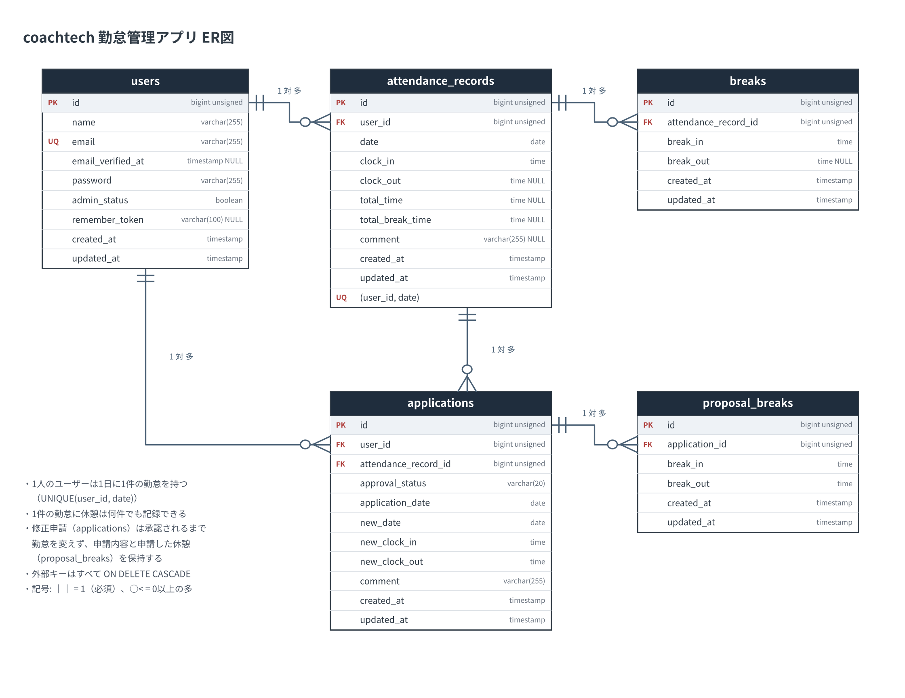
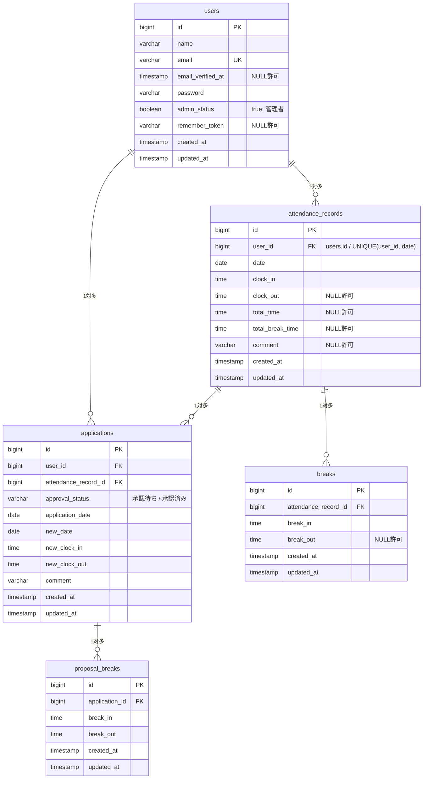

# coachtech 勤怠管理アプリ

## 概要

ある企業が開発した独自の勤怠管理アプリです。一般ユーザーは出勤・休憩・退勤の打刻、勤怠一覧の確認、勤怠の修正申請ができ、管理者はスタッフ全員の勤怠確認・直接修正・修正申請の承認ができます。

### 主な機能

**一般ユーザー**

- 会員登録・ログイン・ログアウト（Laravel Fortify）
- メール認証（Mailpit）・認証メールの再送
- 勤怠打刻（出勤 / 休憩入 / 休憩戻 / 退勤）とステータス表示（勤務外・出勤中・休憩中・退勤済）
- 月次の勤怠一覧（前月・翌月の切り替え）
- 勤怠詳細の確認と修正申請（承認待ちの間は修正不可）
- 申請一覧（承認待ち / 承認済み）
- マイ勤怠レポート（過去6ヶ月の総労働時間・残業時間・平均、月次推移、今月の遅刻・早退・長時間労働）

**管理者**

- 管理者ログイン・ログアウト
- 日次の勤怠一覧（前日・翌日の切り替え）
- 勤怠詳細の確認と直接修正
- スタッフ一覧、スタッフ別の月次勤怠一覧、CSV出力
- 修正申請の一覧（承認待ち / 承認済み）と承認

**公開API**

- 勤怠の一覧・詳細取得（認証不要）と、登録・更新・削除（Sanctum 認証、本人または管理者のみ）

## 使用技術（実行環境）

| 分類 | 技術 |
| --- | --- |
| 言語 | PHP 8.2 |
| フレームワーク | Laravel 10.x |
| 認証 | Laravel Fortify（Web）、Laravel Sanctum（API） |
| データベース | MySQL 8.4 |
| メール | Mailpit |
| 開発環境 | Docker、Laravel Sail、phpMyAdmin |
| フロントエンド | Blade、Vite（提供テンプレート） |
| テスト / 品質 | PHPUnit 10、Laravel Pint |

## 環境構築

Docker（Docker Desktop など）がインストールされ、起動している必要があります。

### 1. リポジトリのクローン

```bash
git clone https://github.com/kazuki-katakura/attendance-app.git
cd attendance-app
```

### 2. Composer パッケージのインストール

ローカルに PHP / Composer がなくても、Sail と同じ PHP 8.2 のコンテナでインストールできます。

```bash
docker run --rm \
    -u "$(id -u):$(id -g)" \
    -v "$(pwd):/var/www/html" \
    -w /var/www/html \
    -e COMPOSER_CACHE_DIR=/tmp/composer_cache \
    laravelsail/php82-composer:latest \
    composer install
```

### 3. 環境変数ファイルの作成

```bash
cp .env.example .env
```

`.env` のデータベース・メールの設定が以下になっていることを確認します。

```dotenv
DB_CONNECTION=mysql
DB_HOST=mysql
DB_PORT=3306
DB_DATABASE=laravel
DB_USERNAME=sail
DB_PASSWORD=password

MAIL_MAILER=smtp
MAIL_HOST=mailpit
MAIL_PORT=1025
```

### 4. Sail の起動

```bash
./vendor/bin/sail up -d
```

> Apple Silicon（M1/M2/M3/M4 等）の Mac でも動作するよう、`compose.yaml` の mysql サービスには `platform: 'linux/amd64'` を設定済みです。

以降は `sail` だけでコマンドを実行できるよう、エイリアスを設定しておくと便利です。

```bash
alias sail='[ -f sail ] && bash sail || bash vendor/bin/sail'
```

### 5. アプリケーションキーの生成・マイグレーション・初期データ投入

```bash
./vendor/bin/sail artisan key:generate
./vendor/bin/sail artisan migrate --seed
```

データベースを作り直す場合は `./vendor/bin/sail artisan migrate:fresh --seed` を実行します。

### 6. フロントエンド（Vite）

```bash
./vendor/bin/sail npm install
./vendor/bin/sail npm run dev
```

`npm run dev` は起動したままにしておきます。開発サーバーを起動せずに確認する場合は、代わりに `./vendor/bin/sail npm run build` を実行してください。

## ログイン情報（シーディングで作成）

| 種別 | 名前 | メールアドレス | パスワード | ログイン画面 |
| --- | --- | --- | --- | --- |
| 一般ユーザー1 | 山田 太郎 | user1@example.com | password | http://localhost/login |
| 一般ユーザー2 | 佐藤 花子 | user2@example.com | password | http://localhost/login |
| 管理者 | 管理者 一郎 | user3@example.com | password | http://localhost/admin/login |

3名ともメール認証済みです。

### ダミーデータ

- 全ユーザーに勤怠（attendance_records）と休憩（breaks）を作成します。
- user1 はマイ勤怠レポート確認用の意図的なデータです（過去5ヶ月は各月平日15日の通常勤務、今月は平日17日を「通常10 / 残業3 / 遅刻2 / 早退1 / 長時間労働1」で作成。すべて休憩 12:00-13:00 付き）。打刻を試せるよう、今日の分は作成していません。
- user1 で `/attendance/report` を開くと、総労働時間 744時間、総残業時間 10時間、平均労働時間 8時間5分 / 日、今月の遅刻 2回・早退 1回・長時間労働 1日 と表示されます。
- user2・管理者は過去2ヶ月〜昨日の平日に、ばらつきのある勤怠を作成します。user2 には修正申請（承認待ち1件・承認済み1件）もあります。

## URL

| 画面 | URL |
| --- | --- |
| 会員登録 | http://localhost/register |
| ログイン（一般ユーザー） | http://localhost/login |
| 勤怠登録（打刻） | http://localhost/attendance |
| ログイン（管理者） | http://localhost/admin/login |
| 勤怠一覧（管理者） | http://localhost/admin/attendance/list |
| phpMyAdmin | http://localhost:8080 |
| Mailpit（認証メールの確認） | http://localhost:8025 |

## ER図





外部キーはすべて `ON DELETE CASCADE` です。このほか、Laravel 標準の `password_reset_tokens`・`failed_jobs`・`personal_access_tokens`（Sanctum）テーブルがあります。

## 画面とルーティング

| 画面 | メソッド | パス | 認証 |
| --- | --- | --- | --- |
| 会員登録 | GET / POST | /register | 不要 |
| ログイン（一般） | GET / POST | /login | 不要 |
| メール認証誘導 | GET | /email/verify | 必要 |
| 勤怠登録（打刻） | GET / POST | /attendance | 必要 |
| 勤怠一覧（一般） | GET | /attendance/list | 必要 |
| 勤怠詳細・修正申請（一般） | GET / POST | /attendance/detail/{id} | 必要 |
| マイ勤怠レポート | GET | /attendance/report | 必要 |
| 申請一覧（一般・管理者共通） | GET | /stamp_correction_request/list | 必要 |
| ログイン（管理者） | GET / POST | /admin/login | 不要 |
| 勤怠一覧（管理者） | GET | /admin/attendance/list | 管理者 |
| 勤怠詳細・直接修正（管理者） | GET / POST | /admin/attendance/{id} | 管理者 |
| スタッフ一覧 | GET | /admin/staff/list | 管理者 |
| スタッフ別勤怠一覧 | GET | /admin/attendance/staff/{id} | 管理者 |
| CSV出力 | POST | /export | 管理者 |
| 修正申請承認 | GET / POST | /stamp_correction_request/approve/{attendance_correct_request_id} | 管理者 |

申請一覧は一般ユーザーと管理者で同じパスを使い、ログインユーザーが管理者かどうかで表示を切り替えます。

## API エンドポイント一覧

| メソッド | パス | 概要 | 認証・認可 |
| --- | --- | --- | --- |
| GET | /api/v1/attendance-records | 勤怠一覧（user_id・date・month で絞り込み、page・per_page でページネーション） | 不要 |
| GET | /api/v1/attendance-records/{attendanceRecord} | 勤怠詳細（ユーザー・休憩・修正申請を含む） | 不要 |
| POST | /api/v1/attendance-records | 勤怠の新規登録 | Sanctum |
| PUT / PATCH | /api/v1/attendance-records/{attendanceRecord} | 勤怠の更新（部分更新に対応） | Sanctum + 本人または管理者 |
| DELETE | /api/v1/attendance-records/{attendanceRecord} | 勤怠の削除 | Sanctum + 本人または管理者 |

- 存在しないIDは `404 {"error": "勤怠情報が見つかりませんでした。"}` を返します。
- 未認証は `401 {"message": "Unauthenticated."}`、権限がない場合は `403 {"error": "この操作を実行する権限がありません。"}` を返します。
- バリデーションエラーは 422 で日本語のエラーメッセージを返します。

### リクエスト例

```bash
# 一覧（認証不要）
curl "http://localhost/api/v1/attendance-records?user_id=1&month=2026-11&per_page=10"

# 登録（Sanctum のトークンを Authorization ヘッダーに付ける）
curl -X POST http://localhost/api/v1/attendance-records \
  -H "Authorization: Bearer <トークン>" \
  -H "Content-Type: application/json" \
  -d '{"date":"2026-11-02","clock_in":"09:00:00","clock_out":"18:00:00","comment":"APIから登録"}'
```

トークンは tinker で発行できます（例: `./vendor/bin/sail artisan tinker` → `App\Models\User::find(1)->createToken('api')->plainTextToken`）。

## テスト

```bash
./vendor/bin/sail artisan test
```

テストは `phpunit.xml` の設定により MySQL の `testing` データベースで実行されます（Sail の MySQL コンテナ初回起動時に自動作成されます）。

カバレッジを確認する場合は、`.env` の `SAIL_XDEBUG_MODE=develop,debug,coverage`（`.env.example` に記載済み）を確認し、コンテナを再起動してから実行します。

```bash
./vendor/bin/sail down && ./vendor/bin/sail up -d
./vendor/bin/sail artisan test --coverage
```

テストは要件シートの「テストケース一覧」ID 1〜20 に対応しています（`tests/Feature/Auth`・`Attendance`・`Admin`・`Api`、`tests/Feature/ReportTest.php`）。

## コードフォーマット

```bash
./vendor/bin/sail bin pint --test
```

## 作成者

片倉 一輝
